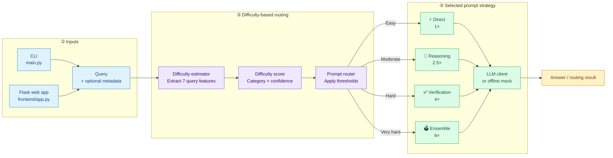
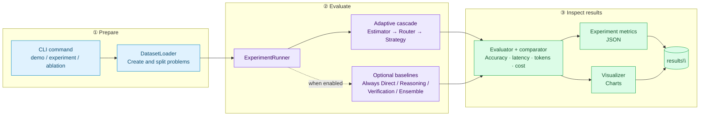

<div align="center">

# 🌊 PromptCascade

### Difficulty-adaptive prompting for more efficient LLM workflows

Route each query to the right level of reasoning: keep simple requests lightweight and give harder ones more verification.

<p>
  
  
  
</p>

<p>
  <a href="#how-to-run"><strong>Get started »</strong></a>
  &nbsp;·&nbsp;
  <a href="#architecture-and-workflow">Explore the workflow</a>
  &nbsp;·&nbsp;
  <a href="#features">View features</a>
</p>

</div>

---

> **At a glance:** Analyze query difficulty → choose a prompting strategy → evaluate quality and cost.

<div align="center">

| 🧭 Adaptive routing | 🧠 Four strategies | 📊 Evaluation | 🖥️ Web interface |
|:---:|:---:|:---:|:---:|
| Difficulty-based decisions | Direct to Ensemble | Baselines and metrics | Try query routing |

</div>

## Contents

[Problem Statement](#problem-statement) · [Our Solution](#our-solution) · [Features](#features) · [Architecture](#architecture-and-workflow) · [Technologies](#tools-and-technologies) · [Run](#how-to-run) · [Configuration](#configuration)

## Problem Statement

Using one prompting strategy for every question can waste computation on simple tasks or provide too little support for complex ones. A useful system should adapt its strategy to the apparent difficulty of each query while making the routing decision and its relative cost visible.

## Our Solution

PromptCascade extracts linguistic and task-related features from each query, calculates a difficulty score, and uses that score to select one of four prompting strategies. Its evaluation tools compare adaptive routing with fixed-strategy baselines. The project runs with mock LLM responses by default, so the demo does not require API credentials.

## Features

- Difficulty scoring from query length, lexical complexity, syntactic depth, numerical complexity, domain specificity, keyword density, and question complexity.
- Confidence and difficulty-category estimates to accompany routing decisions.
- Four strategies: Direct, Reasoning, Verification, and Ensemble.
- Configurable difficulty thresholds and relative strategy cost multipliers.
- Synthetic datasets spanning mathematical reasoning, logical reasoning, question answering, and coding.
- Evaluation against fixed-strategy baselines, with metrics for accuracy, latency, tokens, and cost.
- Experiment result export to JSON and visualizations such as strategy distributions and cost/accuracy comparisons.
- Flask web interface for trying query routing and viewing experiment results.

### Strategy guide

| Strategy | What it does | Relative cost |
|---|---|---:|
| ⚡ **Direct** | Responds without additional reasoning steps. | 1× |
| 🧩 **Reasoning** | Uses a structured reasoning prompt. | 2.5× |
| ✅ **Verification** | Adds a verification step to the response. | 4× |
| 🗳️ **Ensemble** | Generates multiple candidates and selects an answer. | 6× |

## Architecture and Workflow

PromptCascade has two connected workflows: **query routing**, which picks a strategy for a query, and **experiment evaluation**, which measures the routing system over a dataset.

### 1. Query routing

The CLI and Flask interface feed queries into the same difficulty-estimation and routing pipeline. The router selects one strategy based on the configured thresholds; each strategy uses the configured LLM client or a mock response when no client is supplied.



### 2. Experiment and evaluation

The experiment runner creates a dataset, evaluates the adaptive cascade and (optionally) fixed-strategy baselines, then stores metrics and generated charts in `results\`.



#### Workflow at a glance

| Step | Component | Responsibility |
|---|---|---|
| 1 | CLI or Flask UI | Accept a query or start an experiment. |
| 2 | Difficulty estimator | Extract query features and calculate difficulty, category, and confidence. |
| 3 | Prompt router | Compare difficulty to configured thresholds and choose a strategy. |
| 4 | Strategy | Build and run the selected prompt; use mock responses when no LLM client is configured. |
| 5 | Evaluator and visualizer | For experiments, compare metrics and save JSON results and charts. |

## Tools and Technologies

- **Python** for the application and experiment logic.
- **NumPy** for feature calculations and numerical operations.
- **scikit-learn** and **XGBoost** for machine-learning support included in the environment.
- **PyYAML** for reading `config.yaml`.
- **Matplotlib**, **Seaborn**, and **Plotly** for visualization.
- **Flask** for the optional web interface.
- **pytest** for tests.
- **OpenAI**, **Anthropic**, and **Groq** Python packages are listed as optional LLM integrations. The included demo uses mock responses when no LLM client is provided.

## How to Run

### Requirements

- Python 3.10 or later
- pip

Run these commands from the repository root in PowerShell:

```powershell
py -m venv .venv
.\.venv\Scripts\Activate.ps1
python -m pip install --upgrade pip
python -m pip install -r requirements.txt
```

If PowerShell prevents virtual-environment activation, use the Python executable in the environment directly:

```powershell
.\.venv\Scripts\python.exe -m pip install -r requirements.txt
.\.venv\Scripts\python.exe main.py demo
```

### Run the demo

```powershell
python main.py demo
```

This runs an offline demo using mock LLM responses. Results are saved to `results\demo.json`, with figures in `results\figures\`.

### Run an experiment

```powershell
python main.py experiment --samples 1000 --name my_experiment
```

Useful options:

- `--no-baselines` skips fixed-strategy comparisons.
- `--no-visualize` skips chart generation.
- `--config path\to\config.yaml` selects a configuration file. Place this global option before the command, for example `python main.py --config config.yaml demo`.

### Run an ablation study

```powershell
python main.py ablation --samples 500 --name feature_ablation
```

### Start the web interface

Install the Flask dependency and launch the app:

```powershell
python -m pip install -r frontend\requirements.txt
python frontend\app.py
```

Open [http://localhost:5000](http://localhost:5000) in a browser. Stop the server with `Ctrl+C`.

### Run tests

```powershell
python -m pytest
```

## Configuration

Edit `config.yaml` to change the offline LLM settings, difficulty thresholds, strategy cost multipliers, evaluation settings, and dataset settings. The default configuration uses mock responses and does not require API credentials.
